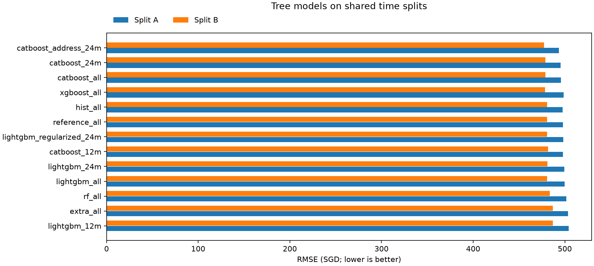
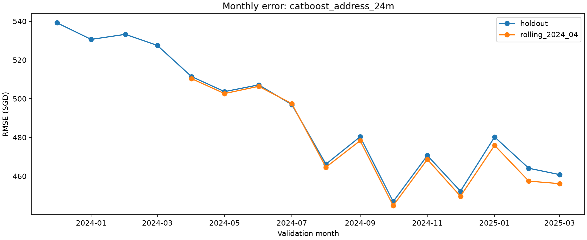
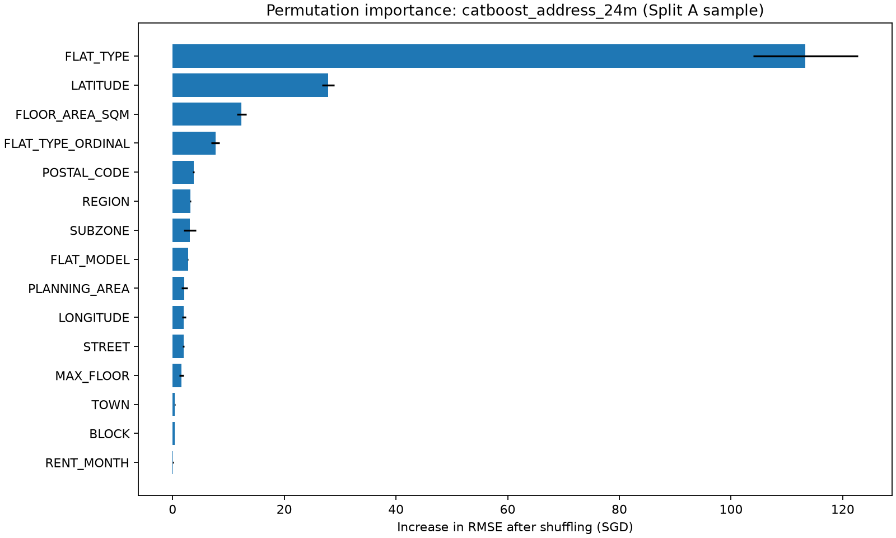

# Yaqi 树模型交付入口

本分支 `yaqi-tree-models` 基于 `data-cleaning` 的 `6eb4f01`，没有修改或合并到 `main`。

由于网页上传不保留本地目录结构，完整代码、Notebook、训练说明、配置、日志和结果按原目录打包在 **yaqi_tree_models_delivery.zip** 中。下方报告、comparison.csv 及三张图也可直接在 GitHub 查看。

## 恢复与使用

1. 检出本分支，下载并将 `yaqi_tree_models_delivery.zip` 解压到项目根目录。
2. 再将其中的 `deliverables/yaqi_tree_results.zip` 解压到同一根目录，恢复所有逐行验证预测、最佳模型及提交 CSV。
3. 查看 `docs/TREE_TRAINING.md`，或打开 `notebooks/Yaqi_tree_models.ipynb`。
4. 原始与清洗数据沿用本分支已有的 `data/` 和 `data_cleaned/`，没有在交付包中重复上传。

`yaqi_tree_models.patch` 提供可审阅的代码与结果变更（不含大型预测压缩包）。交付文件校验值见 `UPLOAD_MANIFEST.json`。

以下是实际实验报告；分数属于本地开发时间验证，不是 Kaggle 排行榜成绩。

---

# Yaqi：树模型实验结果

随机种子：42。以下分数来自实际运行，单位 SGD，越低越好。

| 实验 | split A RMSE | split B RMSE | 两折平均 | 秒数 |
|---|---:|---:|---:|---:|
| catboost_address_24m | 493.617 | 477.309 | 485.463 | 126.6 |
| catboost_24m | 495.419 | 478.852 | 487.135 | 101.9 |
| catboost_all | 495.594 | 478.959 | 487.277 | 134.2 |
| xgboost_all | 498.515 | 478.596 | 488.556 | 11.8 |
| hist_all | 497.577 | 480.493 | 489.035 | 4.4 |
| reference_all | 498.054 | 480.739 | 489.396 | 1.8 |
| lightgbm_regularized_24m | 498.331 | 480.649 | 489.490 | 4.0 |
| catboost_12m | 497.829 | 481.740 | 489.785 | 80.8 |
| lightgbm_24m | 499.553 | 480.997 | 490.275 | 5.1 |
| lightgbm_all | 499.840 | 480.736 | 490.288 | 6.8 |
| rf_all | 501.628 | 483.485 | 492.556 | 569.0 |
| extra_all | 503.514 | 486.971 | 495.243 | 614.9 |
| lightgbm_12m | 504.176 | 486.949 | 495.563 | 4.3 |

## 解释与限制

- split A：训练 2021-01—2023-11，验证 2023-12—2025-03。
- split B：训练 2021-01—2024-03，验证 2024-04—2025-03。
- 两个验证区间有重叠；平均值是两折 RMSE 简单平均，不是独立测试集成绩。
- 原仓库历史分数使用种子 5228；本次按项目规则改为 42，参考模型也重新运行。
- reference/hist 沿用参考模型列；其余模型额外使用 STREET 和类别 FLAT_TYPE。
- 比较算法时先看 all；12m/24m 是训练历史长度消融。address 额外使用邮编与楼号。
- 所有编码、填补、类别词表和近期窗口仅从当前训练折拟合；没有外部目标编码。
- CatBoost 使用库内部的类别统计；未向模型传入验证集标签，不使用外部验证早停。
- 不使用宏观未来实测值、设施快照或队友尚未实现的特征模块。
- 候选参数和轮数预先列在 src/models/trees.py；这是一组有限搜索，不是最优性证明。
- 两折被用于模型选择，分数属于开发验证结果；不能称为未参与调参的泛化评估。
- 树模型不能据此保证 2026 年时间趋势外推；Kaggle 分数需实际上传后确认。
- 保留重复记录、极端租金、测试集全部记录与顺序。

## 产物

comparison.csv 为逐模型汇总；experiments/ 内保存公共框架配置及逐行验证预测。
每个模型有按月份、地区、房型的误差表，可交给 P1 做误差分析与融合。
使用 --final 时仅对当前候选中平均 RMSE 最低的模型做全量重训，并校验提交样例的 Id。

## 最佳模型与图表

本次候选中，两折平均最低的配置是 `catboost_address_24m`，RMSE 为 485.463 SGD。

相对本次复跑的参考模型，平均 RMSE 降低 3.933 SGD（0.80%）。

该结果是当前有限搜索的开发验证比较，没有上传 Kaggle，不能当作排行榜成绩。

## 置换重要性与模型交付

在 split A 固定抽样 2000 条、重复 3 次计算；完整 split A 分数已复现。抽样误差不能替代完整验证分数。相关特征可能分摊重要性，结果不代表因果关系。

模型已保存至 models/best_tree.joblib，重新加载后的全部 50000 个预测与提交一致。最终可用训练记录为 150000 条，按照选定的最近 24 个月策略，实际拟合 71040 条，时间为 2023-04 至 2025-03。

11 项测试通过；13 组实验分数均从逐行预测复核；17 个原始及清洗 CSV 的哈希保持不变。详细记录见 verification.json、model_export.json、test_results.txt。
