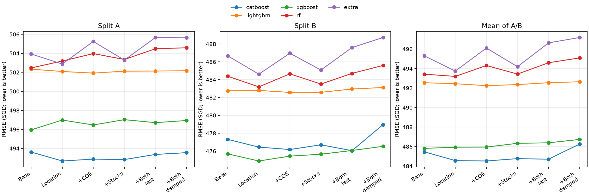
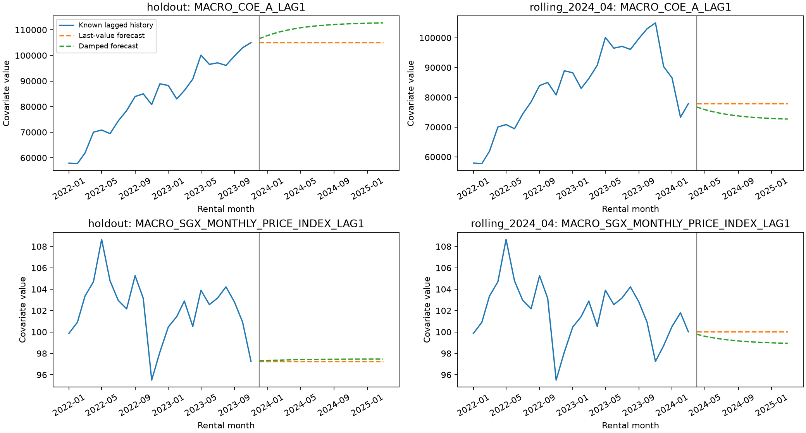
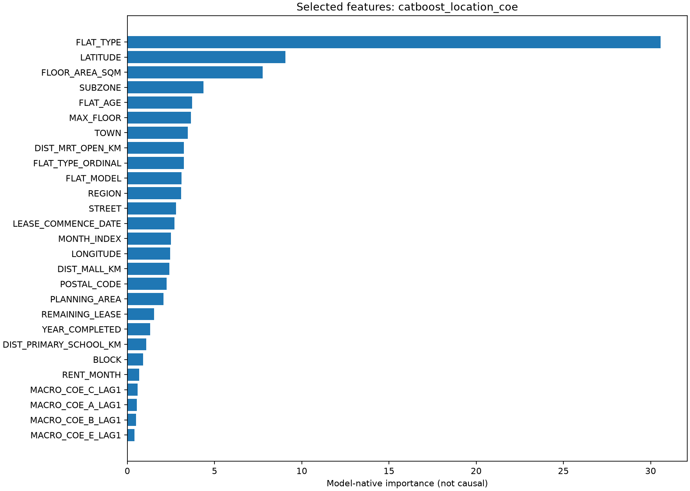

# 位置与经济特征：分阶段树模型实验

随机种子 42；相同 A/B 时间窗口、最近 24 个月训练、地址字段开启，模型参数在各特征阶段不变。
本表包含实际完成的模型：catboost、lightgbm、xgboost、rf、extra。先完成基础与位置阶段，再尝试经济数据。房龄已在基础特征中，没有重复添加。

| 模型 | 特征阶段 | A RMSE | B RMSE | 平均 RMSE | 相对原有特征变化 | 相对位置阶段变化 |
|---|---|---:|---:|---:|---:|---:|
| catboost | 原有特征 | 493.617 | 477.309 | 485.463 | +0.000 | +0.904 |
| lightgbm | 原有特征 | 502.336 | 482.753 | 492.544 | +0.000 | +0.102 |
| xgboost | 原有特征 | 495.948 | 475.680 | 485.814 | +0.000 | -0.120 |
| catboost | 加入设施距离 | 492.679 | 476.439 | 484.559 | -0.904 | +0.000 |
| lightgbm | 加入设施距离 | 502.092 | 482.793 | 492.443 | -0.102 | +0.000 |
| xgboost | 加入设施距离 | 496.984 | 474.885 | 485.934 | +0.120 | +0.000 |
| catboost | 位置＋COE | 492.874 | 476.168 | 484.521 | -0.942 | -0.038 |
| lightgbm | 位置＋COE | 501.918 | 482.572 | 492.245 | -0.300 | -0.198 |
| xgboost | 位置＋COE | 496.466 | 475.429 | 485.947 | +0.133 | +0.013 |
| catboost | 位置＋股票 | 492.829 | 476.699 | 484.764 | -0.700 | +0.204 |
| lightgbm | 位置＋股票 | 502.125 | 482.580 | 492.352 | -0.192 | -0.090 |
| xgboost | 位置＋股票 | 497.025 | 475.644 | 486.334 | +0.520 | +0.400 |
| catboost | 位置＋COE＋股票（持平预测） | 493.368 | 476.039 | 484.704 | -0.759 | +0.145 |
| lightgbm | 位置＋COE＋股票（持平预测） | 502.139 | 482.951 | 492.545 | +0.001 | +0.103 |
| xgboost | 位置＋COE＋股票（持平预测） | 496.711 | 476.059 | 486.385 | +0.571 | +0.451 |
| catboost | 位置＋COE＋股票（阻尼趋势） | 493.553 | 478.958 | 486.256 | +0.793 | +1.697 |
| lightgbm | 位置＋COE＋股票（阻尼趋势） | 502.168 | 483.121 | 492.645 | +0.100 | +0.202 |
| xgboost | 位置＋COE＋股票（阻尼趋势） | 496.935 | 476.526 | 486.730 | +0.916 | +0.796 |
| rf | 原有特征 | 502.465 | 484.382 | 493.424 | +0.000 | +0.233 |
| rf | 加入设施距离 | 503.187 | 483.193 | 493.190 | -0.233 | +0.000 |
| rf | 位置＋COE | 503.972 | 484.651 | 494.311 | +0.888 | +1.121 |
| rf | 位置＋股票 | 503.354 | 483.508 | 493.431 | +0.007 | +0.241 |
| rf | 位置＋COE＋股票（持平预测） | 504.480 | 484.703 | 494.592 | +1.168 | +1.401 |
| rf | 位置＋COE＋股票（阻尼趋势） | 504.584 | 485.594 | 495.089 | +1.665 | +1.899 |
| extra | 原有特征 | 503.931 | 486.668 | 495.300 | +0.000 | +1.554 |
| extra | 加入设施距离 | 502.874 | 484.617 | 493.746 | -1.554 | +0.000 |
| extra | 位置＋COE | 505.245 | 486.957 | 496.101 | +0.801 | +2.355 |
| extra | 位置＋股票 | 503.288 | 485.081 | 494.185 | -1.115 | +0.439 |
| extra | 位置＋COE＋股票（持平预测） | 505.663 | 487.597 | 496.630 | +1.330 | +2.885 |
| extra | 位置＋COE＋股票（阻尼趋势） | 505.635 | 488.725 | 497.180 | +1.880 | +3.434 |

本次候选中平均 RMSE 最低：**catboost_location_coe，484.521 SGD**。
变化列为新阶段减对照阶段，负数表示误差降低。新增特征没有预设一定有效。

## 验证与可得性口径

- A：训练截至 2023-11，验证 2023-12—2025-03；B：训练截至 2024-03，验证 2024-04—2025-03。两个验证窗口重叠，平均为两折 RMSE 简单平均。
- MRT 只取文件 STATUS=open，排除 LRT 与 RTS，按坐标去重；小学只取 MAINLEVEL_CODE=primary。距离为大圆直线距离（km），不是步行距离。
- 地铁、商场、小学没有历史启用日期。位置特征是提供文件的设施快照，不能称为严格重建历史可用设施的回测。宏观截断检查也不能消除这项设施时间口径限制。
- COE 按月份、类别平均竞价 QUOTA_PREMIUM。股票只使用 SGD 的 SGX 股票，按公司计算日 CLOSE 的月均值，再以首月固定股票集合及首月价格归一为 100，取等权均值；不使用 ADJUSTED_CLOSE，不混合不同币种，不是正式 STI 指数。
- 假设月度经济数据延迟一个完整日历月可得；文件没有发布时间，无法进一步核验真实发布时点。A 只用到 2023-10，B 只用到 2024-02；最终训练只用到 2025-02。
- 训练记录 t 使用 t-1 月经济特征。对于固定截止点后的整个验证/测试期间，只使用截止点历史值的持平预测，或预设 12 月窗口、0.8 阻尼、每月对数斜率上限 ±0.03 的趋势预测；不使用验证/测试期实测经济数据。
- 股票固定集合在第一可见月份确定，避免用后续覆盖或表现筛选股票；缺月只向前填充。首个租赁月份没有前月数据，保持缺失。
- 全部编码、缺失处理、经济历史截断及经济预测参数均在当前训练折拟合。没有用验证标签早停或调参。
- 补充的随机森林与 ExtraTrees 沿用 160 棵树、最大深度 24、叶子最少 8 条、max_features=0.8。模型选定的输入字段全部保留；one-hot 每字段最多 32 类，低频类别合并，词表及分组只在训练窗口拟合。这个编码预算在六阶段固定，与原始首轮无限类别上限的森林实现有区别，不能直接将两轮差值归因于新增特征。
- 这些 A/B 窗口用于阶段选择，分数属于开发验证结果，不是未参与选择的独立评估，也不是 Kaggle 成绩。
- 保留全部租金标签、重复记录与原始行序。旧 outputs/trees/ 的历史实验不覆盖。

## 文件

comparison.csv：逐模型、逐阶段分数；experiments/：公共日志、配置与逐行验证预测；audit_*.json：来源与时间截断；covariates_*.csv：各折历史及未来经济输入。
*_by_*.csv：按月份、地区、房型的误差；best_model.json：推荐配置和提交路径；models/：完整特征流水线与模型；verification.json：重算分数、行序、数据哈希及提交核对。

## 最终交付与解读

共完成 30 组配置。推荐配置 `catboost_location_coe` 的 A/B 平均 RMSE 为 484.521 SGD，相对上一轮复跑最佳 CatBoost 的 485.463 改善 0.942 SGD（0.19%）。

以下在同一 CatBoost 参数下比较各阶段，便于区分位置和经济特征的作用：

| 阶段 | A | B | 平均 RMSE |
|---|---:|---:|---:|
| 原有特征 | 493.617 | 477.309 | 485.463 |
| 加入设施距离 | 492.679 | 476.439 | 484.559 |
| 位置＋COE | 492.874 | 476.168 | 484.521 |
| 位置＋股票 | 492.829 | 476.699 | 484.764 |
| 位置＋COE＋股票（持平预测） | 493.368 | 476.039 | 484.704 |
| 位置＋COE＋股票（阻尼趋势） | 493.553 | 478.958 | 486.256 |

总体差异较小；有限开发验证结果不能证明稳定泛化或经济变量的因果作用。图中的经济未来曲线全部是截止点生成的预测，没有画入未来实测值。

模型原生重要性用于检查已选模型的输入使用情况，不同库的度量不能直接比较，也不等于因果贡献。
森林模型的重要性按原字段汇总 one-hot 编码列及相应缺失指示列，避免把一列展开后的权重误配到原字段。

## 五类模型的覆盖

| 模型 | 已完成阶段数 | 最低平均 RMSE | 对应阶段 |
|---|---:|---:|---|
| catboost | 6 | 484.521 | 位置＋COE |
| lightgbm | 6 | 492.245 | 位置＋COE |
| xgboost | 6 | 485.814 | 原有特征 |
| rf | 6 | 493.190 | 加入设施距离 |
| extra | 6 | 493.746 | 加入设施距离 |

两种森林的六阶段完整 A/B 表、地区误差、字段重要性及与推荐模型的误差相关性见 [森林补充报告](FOREST_REPORT.md)。

推荐模型可用训练数据 150000 条，按选定 24 月窗口实际拟合 71040 条（2023-04—2025-03）。提交文件为 `submissions/best_feature_model.csv`，共 50000 条。模型保存与重载预测、提交编号、真实数据未来扰动及所有分数的独立复核见 verification.json。

另存位置版模型 `models/location_only_model.joblib` 与 `submissions/location_only_model.csv`，A/B 平均为 484.559 SGD，不含经济特征。两份模型均已核对保存重载后的完整 50000 个预测。
