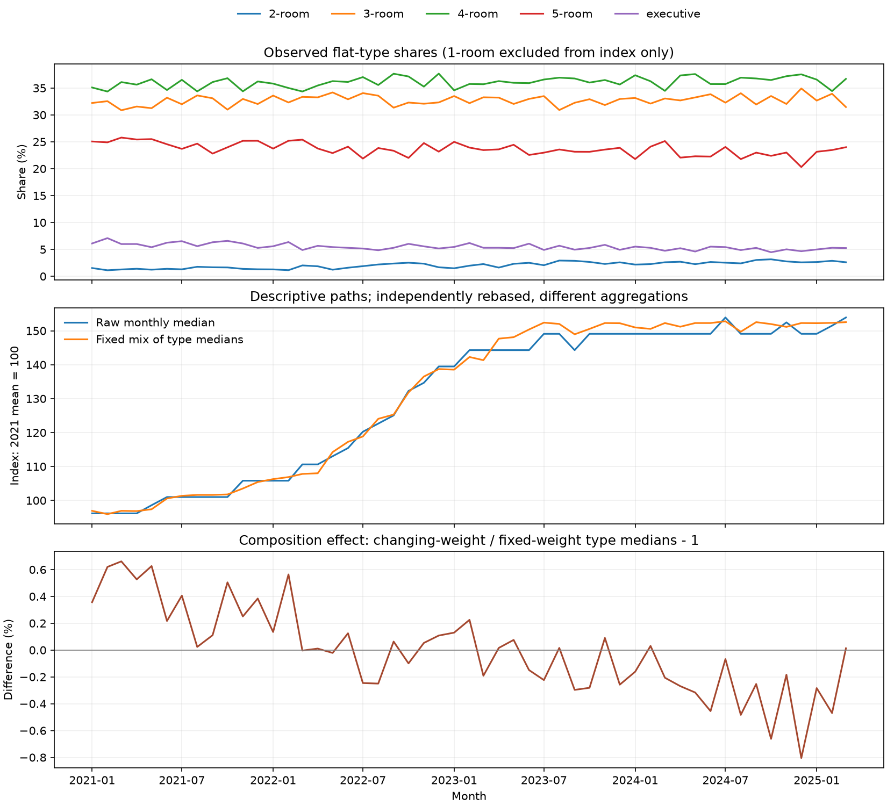

# 固定房型构成指数：可行性检查

仅做数据描述，不训练租金模型、不预测未来、不修改正式融合结果。

用2-room、3-room、4-room、5-room、executive各月租金中位数，按当前训练视图中固定的房型占比加权。
1-room仅不参与指数计算，原始及模型训练记录不删除。房型中位数的加权平均不是全体租金的中位数。

全训练集视图用于描述已知历史。A/B视图分别只用对应训练部分重算权重与指数，没有读取该折验证标签。

构成影响通过同一组房型中位数的变动权重和固定权重之差计算；直接比较整体中位数与加权指数不能把差异全归因于构成。

样本支持见flat_type_support.csv；月度曲线与权重见各视图CSV；全部实测统计及数据指纹见report.json。

Bootstrap仅为月内样本误差诊断，未考虑同楼栋相关性，不是未来预测区间。没有证明该指数可降低模型RMSE。

